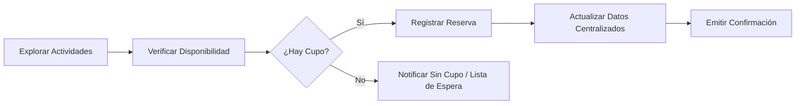

# TuyTuy — Plataforma Centralizada de Reserva de Actividades

[TOC]

---

## 📋 Descripción Breve

> **TuyTuy** es una aplicación diseñada para centralizar, organizar y gestionar en un solo lugar todos los datos y procesos relacionados con la **reserva de actividades**.

El proyecto propone resolver la fragmentación de información entre proveedores y usuarios finales mediante una plataforma unificada que permite consultar disponibilidad en tiempo real, administrar cupos y consolidar el historial de reservaciones de forma ágil y confiable.

---

## ⚙️ Alcance Funcional

### Funcionalidades Principales

- [x] **Centralización de Datos:** Unificación de catálogos de actividades, horarios, ubicaciones y tarifas en un único repositorio.
- [x] **Gestión de Reservas:** Registro, confirmación, modificación y cancelación de reservaciones de actividades.
- [x] **Control de Disponibilidad y Cupos:** Validación automática de capacidad por actividad y bloqueo de sobrecupos.
- [x] **Panel de Consulta:** Visualización consolidada del estado de las reservas para usuarios y organizadores.
- [ ] **Notificaciones y Recordatorios:** Alertas automáticas sobre confirmaciones y cambios de horario *(En planificación para el semestre)*.

---

### Módulos del Sistema

| Módulo | Función Principal | Actores Involucrados |
| :--- | :--- | :--- |
| **Catálogo de Actividades** | Publicación y búsqueda filtrada de actividades disponibles | Usuarios / Proveedores |
| **Motor de Reservas** | Procesamiento y validación de solicitudes de reserva | Usuarios / Sistema |
| **Gestión de Cupos y Horarios** | Control de calendario, aforo máximo y disponibilidad | Proveedores / Administradores |
| **Historial y Reportes** | Centralización de métricas, estados y registros de reservas | Administradores |

---

### Flujo Funcional de Reserva

---

## 📬 Contacto

Para consultas, sugerencias o colaboración sobre el desarrollo del proyecto durante este semestre:

* **Autor / Desarrollador:** Fidel Toro (`@fidelgtc`)
* **Correo Electrónico:** [fidelgtc@gmail.com](mailto:fidelgtc@gmail.com)
* **GitHub:** [github.com/fidelgtc](https://github.com/fidelgtc)
* **Proyecto / Asignatura:** ATI2 - 2026 (PoC)
